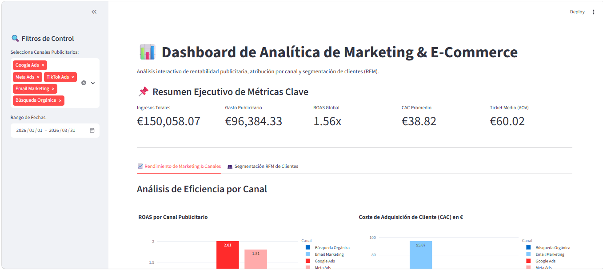
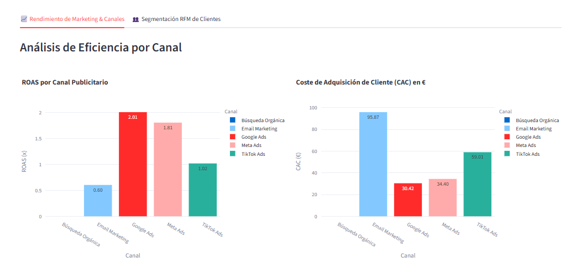
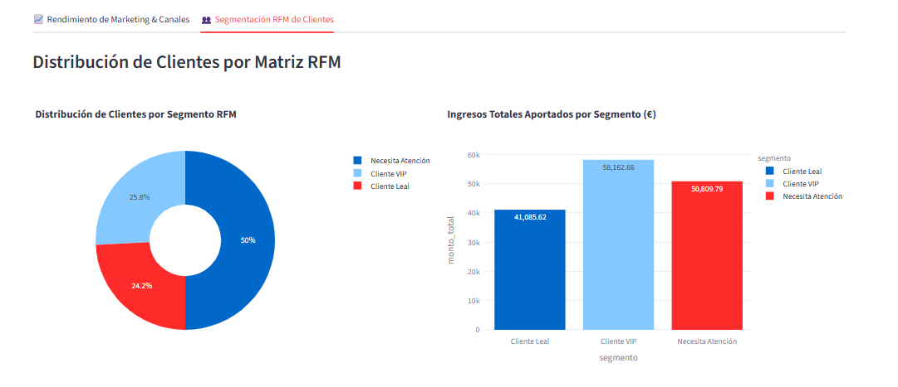

# 📊 E-Commerce Marketing Analytics & Customer Segmentation Dashboard


Solución analítica *end-to-end* diseñada para evaluar la rentabilidad del mix de medios publicitarios y la segmentación de clientes en comercio electrónico. Este proyecto simula, procesa, valida y visualiza métricas de adquisición (ROAS, CAC, AOV) y retención (Segmentación RFM) utilizando una base de datos relacional SQLite y un dashboard interactivo en Streamlit.

---

## 📸 Vista General del Dashboard

<p align="center">
  
</p>

<p align="center">
  
  
</p>

---
[](https://ecommerce-marketing-analytics-h9dvxdzdt3gpnfknanvmkq.streamlit.app/)

🚀 **Demo en vivo:** [https://ecommerce-marketing-analytics-h9dvxdzdt3gpnfknanvmkq.streamlit.app/](https://ecommerce-marketing-analytics-h9dvxdzdt3gpnfknanvmkq.streamlit.app/)

## 🔍 Hallazgos de Negocio & Recomendaciones Estratégicas

### 1. Desempeño General del Negocio
* **Ingresos Totales:** €150,058.07 generados frente a un **Gasto Publicitario Total** de €96,384.33.
* **ROAS Global:** **1.56x**, indicando retorno positivo general pero con oportunidad de optimizar la asignación presupuestaria.
* **CAC Promedio:** **€38.82** con un **Ticket Medio (AOV)** de **€60.02**.

### 2. Atribución Publicitaria por Canal (Mix de Medios)
* **Google Ads (Líder en Rentabilidad):** Canal más eficiente con un **ROAS de 2.01x** y el CAC pagado más bajo (**€30.42**). *Recomendación:* Incrementar asignación presupuestaria.
* **Meta Ads (Rendimiento Consistente):** Retorno sólido de **1.81x ROAS** y un **CAC de €34.40**. *Recomendación:* Escalar campañas y optimizar creativos.
* **TikTok Ads (Punto de Equilibrio):** Opera en la frontera de rentabilidad (**1.02x ROAS**) con un **CAC elevado (€59.01)**. *Recomendación:* Ajustar segmentación de audiencias y embudos.
* **Email Marketing (Desalineación de Captación):** Muestra un **ROAS de 0.60x** y un **CAC de €95.87**. *Diagnóstico:* Redirigir el canal exclusivamente a retención y fidelización de base existente.

### 3. Segmentación RFM de Clientes
* **Clientes VIP (25.8% de la base):** Aportan la mayor concentración de ingresos con **€58,162.66** acumulados.
* **Clientes Leales (24.2% de la base):** Generan **€41,085.62** con compras recurrentes.
* **Segmento "Necesita Atención" (50.0% de la base):** Representa la mitad de los usuarios y **€50,809.79** de ingresos. *Acción:* Implementar flujos automatizados de *re-engagement*.

---

## 🛠️ Estructura del Proyecto

```text
ecommerce-marketing-analytics/
├── assets/                  # Capturas de pantalla e imágenes para documentación
├── data/
│   ├── raw/                 # Datasets sintéticos en bruto (ventas, marketing)
│   ├── processed/           # Datasets limpios con métricas calculadas (CSV)
│   └── ecommerce.db         # Base de datos relacional SQLite
├── notebooks/               # Análisis exploratorio y prototipado
├── sql/
│   ├── schema.sql           # Definición de tablas y restricciones (DDL)
│   └── kpi_queries.sql      # Consultas SQL analíticas ejecutivas
├── src/
│   ├── generar_datos.py     # Simulación de transacciones y campañas
│   ├── procesar_datos.py    # ETL Pipeline y lógica de negocio (RFM / KPIs)
│   └── cargar_a_sqlite.py   # Carga e integración relacional
├── tests/
│   └── test_calidad_datos.py# Pruebas unitarias automatizadas con Pytest
├── app.py                   # Aplicación interactiva en Streamlit
├── requirements.txt         # Dependencias del proyecto
└── README.md                # Documentación ejecutiva